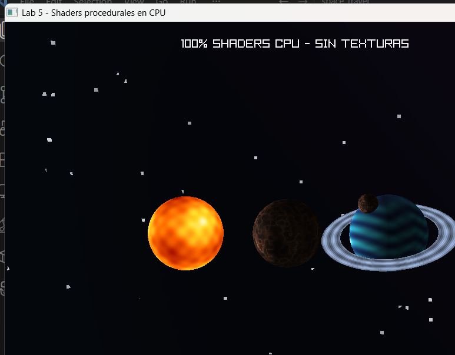

# Lab 5 — Shaders procedurales

Escena de tres cuerpos celestes renderizados íntegramente mediante el software renderer en CPU. Los cuerpos no utilizan texturas ni materiales de imagen: todos sus colores se calculan en shaders de fragmentos.

## Cuerpos

- **Estrella de plasma:** macroconvección, microgranulación, rampa térmica y animación temporal.
- **Planeta rocoso:** continentes basálticos, cráteres, grano mineral e iluminación solar.
- **Gigante gaseoso:** bandas latitudinales, turbulencia, tormenta ovalada, bruma polar y borde atmosférico.
- **Sistema de anillos:** malla independiente con bandas radiales y polvo procedural, sin texturas.
- **Luna:** malla independiente con shader rocoso y traslación orbital.

## Ejecución

```bash
cargo run --release
```

La escena rota y se anima automáticamente usando tiempo transcurrido. Raylib se utiliza solamente para crear la ventana y presentar el framebuffer calculado por CPU.

## Captura

La captura de la entrega se encuentra en `screenshots/lab5_shaders.png`.



## Capas de color

El shader más complejo es el gigante gaseoso:

1. Bandas latitudinales deformadas.
2. Turbulencia fina animada.
3. Tormenta ovalada localizada analíticamente.
4. Bruma polar y Fresnel atmosférico.
5. Iluminación procedente de la estrella.

Los anillos y la luna son modelos separados del gigante gaseoso, como solicita el laboratorio.
